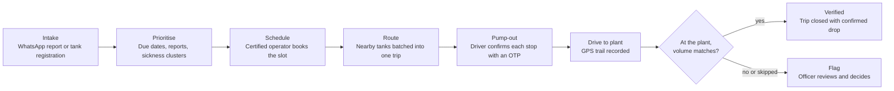

# NaliWatch

A web platform that tracks every load of septic waste from the household to an authorized treatment plant, and uses citizen reports and health signals to decide which tanks to empty first.


---

## The problem

Septic tanks are emptied late or never, workers still enter tanks by hand, and some tankers dump sewage into drains, fields or water bodies. Nobody can prove where a load went.

## The solution

1. Households register their tanks.
2. Anyone can report a problem on WhatsApp (photo, voice note or location).
3. AI ranks tanks by urgency.
4. A scheduler books certified operators.
5. A router batches nearby tanks into one trip.
6. Each load is verified at a treatment plant.

## Goals

- Every registered tank is emptied before it overflows
- Every tanker trip ends in a verified drop at an authorized plant
- Every unsafe manual cleaning report gets a certified operator dispatched
- Ward officers see risk and dumping hotspots on one map

### Pilot success metrics

Proposed targets. Baselines are measured in the first two weeks.

| Metric | How it is measured | Proposed target |
|---|---|---|
| Tanks emptied on schedule | Completed trips vs due date | 80% |
| Trips with a verified drop | Plant confirmation matched to trip | 95% |
| Flagged trips reviewed | Time from flag to officer decision | Within 24 hours |
| Manual cleaning report to dispatch | Report time to operator assigned | Under 2 hours |
| Report to resolution | Report time to ticket closed | Median under 3 days |

---

## End-to-end flow

Every pump-out becomes a trip with a driver, a GPS trail and a plant check. **A trip closes only when the plant confirms the load.** A skipped plant or a volume mismatch goes to a ward officer as a flag.



### Verification rule

A trip counts as verified only when it reaches a plant geofence inside its time window **and** the volume received is within a tolerance of the volume pumped. The municipality sets the tolerance. Any other result creates a flag.

---

## Users and roles

| Role | Who | What they do | Main channel |
|---|---|---|---|
| Household | Owner of a home or building with a septic tank | Registers the tank, books or approves a pump-out, reports problems | WhatsApp, mobile web |
| Reporter | Any resident or volunteer | Sends a photo, voice note or location of an overflow, dumping or manual cleaning | WhatsApp |
| ASHA worker / volunteer | Community health worker | Adds sickness counts for a lane or area | WhatsApp |
| Operator | Certified desludging company | Accepts jobs, assigns tankers and drivers, sees payments | Web dashboard |
| Driver | Tanker driver | Follows the route, confirms each pick-up, delivers to the plant | Mobile web app |
| Plant staff | Treatment plant operator | Confirms each arriving load and its volume | Tablet or web |
| Ward officer / admin | Municipal staff | Sees the risk map, reviews flags, manages operators and plants, exports reports | Web dashboard |

**Access rules:** households see only their own tanks; drivers see only today's assigned trips; ward officers see their own wards; platform admins manage operators, plants and certifications.

---

## Features

| Module | MVP (pilot) | Phase 2 | Phase 3 |
|---|---|---|---|
| Tank registry | Register tank with address, pin, capacity, type, last emptied date | Tank photo, QR plate, ownership transfer | Bulk import from municipal property records |
| Citizen reporting | WhatsApp photo, voice and location reports in Hindi and English | More languages, status updates to reporter | IVR phone line for feature phones |
| Health signal | ASHA workers log sickness counts for an area | Link to clinic or surveillance data | Early-warning alerts to health officers |
| Prediction | Rule-based due dates | Model trained on completed trips and fill-time history | Seasonal and rainfall adjustments |
| Scheduling | Book a pump-out, match to an available certified operator | Slots, reminders, rescheduling, operator ratings | Auto-booking for subscribed households |
| Routing | Batch nearby tanks into one trip, ordered by distance and urgency | Live re-routing for urgent jobs | Multi-depot and capacity-aware planning |
| Trip tracking | Digital trip ticket, driver app with GPS trail, OTP pick-up confirmation | Tank volume entry at pick-up, photo proof | Flow-meter or sensor integration |
| Disposal verification | Plant staff confirm each load at a geofenced gate, mismatches flagged | Weighbridge or flow-meter data, auto reconciliation | Plant-side treatment quality records |
| Dumping and safety | Dumping and manual-cleaning reports trigger a flag and operator dispatch | Repeat-offender scoring | Link to enforcement and penalty workflow |
| Maps and dashboards | Live map of tanks, reports, trips, plants, clusters and flags | Ward comparison, downloadable reports | Public transparency page |
| Admin | Operator and plant onboarding, certification records, roles | Audit log viewer, configurable rules | Multi-city tenancy |

**Not in the MVP:** online payments, sensor hardware, enforcement actions and native mobile apps.

---

## System architecture

One API sits between every channel and the data.

```
CHANNELS    WhatsApp/Telegram bot · Web dashboards · Driver web app
                              │
BACKEND     API and access control (phone OTP login, roles, REST, live updates)
              ├─ Report intake   (Claude vision, speech to text)
              ├─ Prediction      (due dates, ranking, DBSCAN clusters)
              ├─ Scheduling      (operator booking, OR-Tools routing)
              └─ Verification    (geofence and volume rules, flags)
                              │
DATA        Postgres + PostGIS · Object storage · Redis + job workers
```

External services: WhatsApp provider, Claude API, speech to text, OSRM routing.

## Tech stack

| Layer | Choice |
|---|---|
| Web app | Next.js, TypeScript, Tailwind |
| Maps | MapLibre GL JS with OpenStreetMap tiles |
| Driver app | Progressive web app first; Android app via Capacitor later (browsers limit GPS when the screen is off) |
| Backend API | Python with FastAPI |
| Database | PostgreSQL with PostGIS (managed, e.g. Supabase or AWS RDS) |
| Auth | Phone OTP login with role-based access |
| Background jobs | Redis with Celery |
| File storage | S3-compatible bucket |
| Messaging | WhatsApp Business Platform (Cloud API) via a provider, SMS fallback; Telegram for the hackathon demo |
| Vision and text AI | Claude API with structured JSON output |
| Speech to text | Bhashini or Whisper (transcribe first, then classify the text) |
| Route planning | Google OR-Tools with OSRM or OpenRouteService |
| Clustering | PostGIS `ST_ClusterDBSCAN` or scikit-learn DBSCAN |
| Live updates | WebSockets or database realtime channels |
| Hosting | Vercel (web), container host for the API (AWS ECS, Render or Railway), Mumbai region for data |
| Monitoring / CI | Sentry, uptime checks, GitHub Actions |

### Hackathon shortcut

Next.js + Supabase (Postgres, auth, storage, realtime) + a Telegram bot + the Claude API + seeded demo data. Skip real GPS and plant integration; simulate them with a trip simulator.

---

## Data model

Three chains: **tank → jobs → trip → disposal record**. Reports and health signals feed priority; flags sit on top of trips and reports. All locations use PostGIS geometry.

| Table | Key fields |
|---|---|
| `users` | phone, name, role, ward |
| `properties` | address, location pin, ward, owner |
| `tanks` | capacity (litres), type, install year, last emptied, predicted due date, QR code |
| `reports` | type, severity, photo/voice links, text, location, source, status |
| `health_signals` | case count, symptoms, location, reported time |
| `clusters` | centre, radius, status, score, computed time |
| `operators` | company, certification number, valid until, status |
| `vehicles` | plate, capacity (litres), status |
| `drivers` | name, licence, status |
| `jobs` | priority, requested window, status, source report |
| `trips` | planned route, status, start and end time |
| `trip_stops` | sequence, arrival time, volume pumped (litres), OTP confirmed |
| `gps_points` | location, recorded time |
| `plants` | name, authorization number, geofence polygon, valid until |
| `disposals` | arrival time, volume received (litres), confirmed by, result (matched / mismatch) |
| `flags` | reason, status, reviewed by, decision |
| `audit_log` | actor, action, record, time |

---

## AI and agents

Use a language or vision model only where the input is messy human content. Use plain code for anything involving routes, volumes or money, because those decisions must be repeatable and auditable.

| Component | Job | Built with |
|---|---|---|
| Report classifier | Labels problem type and severity (1 to 3) from photo, text, location, with confidence and short reason | Claude vision, structured JSON |
| Voice intake | Turns a voice note in any local language into a report | Speech to text, then Claude |
| Desludging estimator | Predicts when each tank is due | Formula first, trained model once trip data exists |
| Priority ranker | Orders tanks and reports by urgency | Scoring rules |
| Cluster engine | Finds areas where failures and sickness overlap | DBSCAN on locations |
| Scheduling agent | Books jobs with certified operators | Constraint matching; Claude for chat wording |
| Route agent | Batches nearby tanks into trips | OR-Tools vehicle routing |
| Disposal verifier | Checks each load reached an authorized plant | Geofence and volume rules |

### Estimator formula (first version)

```
due date = last emptied + (capacity × fill limit) / (occupants × sludge per person per day)
```

Fill limit and sludge per person per day come from local guidance and are tuned on real trip data.

### Guardrails

- A person reviews every dumping flag. The system never penalises an operator on its own.
- Photo severity is advice to the officer; an officer can change the score.
- Store the model's reason and confidence with each classification for auditing.
- Reject photos that show faces or house interiors, and blur faces before storage.

---

## Integrations and partners

The pilot succeeds or fails on four partners: the municipality, a few certified operators, one treatment plant and the local health team.

| Integration | Purpose | Phase |
|---|---|---|
| WhatsApp Business Platform | Resident reports and notifications (needs business verification and pre-approved templates) | MVP |
| SMS and OTP | Login codes, reminders (needs DLT registration for commercial SMS in India) | MVP |
| Maps and routing | Basemap, road distances, route display | MVP |
| Speech to text | Voice notes in local languages | MVP |
| Claude API | Photo and text classification (daily cost cap and fallback needed) | MVP |
| Ward boundaries | Assign reports and tanks to wards | MVP |
| Treatment plant | Confirm each arriving load | MVP, then Phase 2 |
| Tanker GPS | Trail and geofence checks | MVP, then Phase 2 |
| Payments (UPI) | Pay operators, collect household fees | Phase 2 |
| Health data | Compare sickness counts with failures | Phase 2 |
| Property records | Pre-fill households, find unregistered tanks | Phase 3 |

**Partners to sign before the pilot:** an urban local body or ward office, two or three certified desludging operators, one authorized treatment plant, a health department contact for ASHA onboarding, and a WhatsApp provider with Indian language support.

---

## Security, privacy and compliance

The platform holds home addresses, phone numbers, health counts and driver locations. Treat privacy as a launch requirement, and have a lawyer confirm the legal points for the pilot state before go-live.

**Security**
- Role-based access on every record, enforced in the database as well as the API
- Phone OTP login, short sessions, rate limits on report intake
- Encryption in transit and at rest; private media storage with signed links
- Audit log of who viewed or changed a trip, flag or household record
- Daily backups and a tested restore

**Privacy**
- Collect only what each role needs; consent at household registration and when a driver starts a GPS shift
- Public pages show only ward-level counts and hotspots, never names or exact addresses
- Blur faces before storage; delete raw voice files after transcription
- Health signals are area counts, never named patients
- Hold data in an Indian cloud region; set retention periods for photos, audio and GPS trails

**Legal and policy points to check**
- Digital Personal Data Protection Act, 2023
- Prohibition of Employment as Manual Scavengers and their Rehabilitation Act, 2013
- State and municipal rules for septic tank cleaning, operator licensing and approved disposal sites
- WhatsApp Business Platform policies on templates and consent

**Abuse and misuse**
- A flag is a lead for human review; no operator is accused on the system's word alone
- Reports from the same person or place are rate limited and de-duplicated
- Reporter identity is hidden from operators, especially for dumping and manual cleaning reports

---

## Roadmap

Build the demo now, then earn each next phase by passing a gate. Durations are proposals.

| Phase | Scope | Exit gate | Time |
|---|---|---|---|
| 1. Hackathon demo | Telegram/WhatsApp bot, map with clusters, one simulated tanker trip, plant check, dumping flag, seeded data | A 3-minute demo runs end to end without manual fixes | The hackathon |
| 2. Pilot build | Real login, tank registry, scheduling, route batching, driver web app, plant confirmation page, admin dashboard | One operator completes 10 real trips with verified drops in a test area | ~8 weeks |
| 3. Ward pilot | One ward live with 2 to 3 operators, one plant, ASHA workers reporting | Pilot targets met for 4 weeks | ~3 months |
| 4. City rollout | More wards, payments, tanker GPS devices, public transparency page | Municipality adopts it as the official trip record | After pilot gate |

### Hackathon build order

1. Database schema and seed data for one ward
2. Map with tanks, reports and clusters
3. Bot that creates a report and shows it on the map
4. Scheduler and route batch for three tanks
5. Trip simulator that ends at a plant, once matched and once skipped
6. Flag screen and the final demo script

### Hackathon team split

- **Map and dashboard:** ward map, pins, clusters, trip status, flag list
- **Backend and data:** schema, seed data, trip simulator, verification rule
- **Bot and AI:** report intake, photo classification, voice notes, replies
- **Pitch and story:** demo script, slides, answer to "why will operators use this?"

---

## Risks

The biggest risk is adoption, not technology. Operators, drivers and plant staff must gain something from being tracked, or they will work around the system.

| Risk | Mitigation |
|---|---|
| Operators resist tracking | Give them value: steady job queue, shorter routes, faster payment, a verified record that protects them from false dumping claims |
| Plants do not confirm loads | Start with one willing plant and a simple tablet page; add weighbridge/flow-meter data later |
| Driver phone GPS drops out | Native wrapper, photo confirmation backup, flag gaps for review instead of accusing |
| False dumping flags | Human review of every flag, municipality-agreed tolerance, check for GPS gaps first |
| Households do not register | Operators and ward staff register tanks during pump-outs, QR plate on the tank, WhatsApp registration |
| Spam or unclear reports | Rate limits, confidence thresholds, manual review queue for low-confidence photos |
| Language and literacy | Voice notes, local languages, ASHA workers who can report for others |
| Slow health data sharing | Begin with ASHA worker reports only; add clinic data later |
| AI outage or cost spike | Daily cost cap and a fallback queue where staff classify reports by hand |
| Manual cleaning is an emergency | Route to a named human responder with a phone number; never rely on an app alert alone |

## Open questions

- Which city and ward will host the pilot?
- Who authorizes operators and plants, and can we get their registers?
- Who pays: the municipality by subscription, operators per trip, or households?
- What volume mismatch counts as a flag?
- Which languages are needed at launch?
- Who is the human responder for manual cleaning reports?

---

*Source: NaliWatch Product and Build Plan, Nov 14, 2026.*
